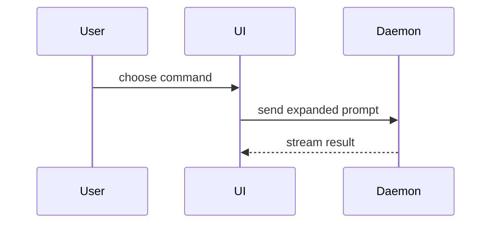

Write the body to a file in your scratchpad with this template, check it, then post it:

```markdown
Refs #N

## Summary

<diagram, diff-sketch, or tree>

## Evidence

- **Before:** <the red run: `scripts/test.sh --red origin/main` or the failing test>
  **After:** <the passing run>
- **Scores:** <scripts/eval-quick.sh's numbers; only when speech, Cleanup or the Lexicon changed>

**Check script:** <the line `node scripts/pr-body-check.mjs --numbers` prints>

<the lexicon-review Workflow's markdown, its table rows collapsed, then your Fixed and Helpers lines>

## Merge Danger

**Door:** <one-way or two-way>

<optional: description>

**Blast Radius:** <one word from the list below>

<optional: potential ramifications of merge>

## Install

<every step installing it needs: a new permission, a data migration, a model download; or "Code only.">

Try (about N min): <the one thing Jake should try once it is installed>
```

Then:

```bash
node scripts/pr-body-check.mjs <body file> && gh pr create --base main --title "<title>" --body-file <body file>
```

The same check runs before every `gh pr edit --body-file`. It names each rule the body breaks; fix the body, never the check.

## What the check holds you to

- **`Refs #N`** alone on the first line. It links the PR to its issue; words after the number make it prose. Never a closing keyword (any form of close, fix or resolve before an issue, such as "Fixed #12"), in the body or in any commit: closing a ticket is the merge step's job (#88 Q11).
- **The headings** Summary, Evidence, Merge Danger, Install, in that order. `**Door:**` starts one-way or two-way.
- **`**Blast Radius:**`** is one word: capture, history, insertion, fn, network, privacy, permissions, bundle, speech, cleanup, lexicon, ui, eval, scripts, agents, ci, tests, docs or none. Pick the area a bad merge hurts most; the description below it says how.
- **`Try (about N min):`** after Install, with the one thing Jake should try once it is installed and about how long it takes him. It is the line Jake's Try list takes (#88 Q11); an older `Check:` line still passes the check but gives the list nothing. At most one line of at most 12 words may follow it: the footer your tool adds.
- **750 words at most.** A word is a whitespace-separated token with a letter or digit in it, so table rules and tree branches don't count but every word in a tree does. The count stops at that closing line, so the one footer line after it (the "Generated with" line) is not counted. A closed `<details>` block is not counted either, because Jake opens it only when he wants it; one left open hides nothing.
- **Numbers from the check, never typed.** `node scripts/pr-body-check.mjs --numbers` prints the `**Check script:**` line from `.build/check-summary.json` (steps, tests run, failed, at which sha), and the check refuses a body without that exact line or a summary for other content. After a merge of `main`, rerun `scripts/check.sh` first. A lag, memory or speed number comes from `bench-runner`'s table, never a hand run.
- **Scores** whenever speech, Cleanup or the Lexicon changed (the `Scores` paths in `.claude/workflows/review-map.json`, less the eval tooling): a `**Scores:**` line with `scripts/eval-quick.sh`'s numbers (words heard right, Terms right, lag). "none" fails. Any score that got worse also goes on the line after `Refs #N`, before Summary: `Score worse: <which score, before and after>`.
- **No em dash, no `/Users/` path, no handle mention** (the at-sign before Codex's or Claude's name, which can start a cloud task on Jake's plan; write "Codex's handle").
- **A departure from the spec links its decision.** Words like "deviates", "departs from", "unlike the spec" need a link (a URL or `[...](...DECISIONS.md...)`) to the `docs/DECISIONS.md` entry holding Jake's recorded decision; naming the file is not enough. A departure Jake never decided doesn't ship; implement-ticket's Need Jake asks him first.

## Review and Helpers

Paste the lexicon-review Workflow's `markdown` (on Codex, what `scripts/codex-review.mjs` printed) from its last run (the one whose reviewed sha is the head you push). Put the table's rows in a `<details><summary>Findings</summary>` block and keep the reviewed-sha line, the Counted line and any INCOMPLETE line outside it. Under it:

- **Fixed:** one line per CONFIRMED finding: where, what changed, and `red test: <test name>` (the test that failed first, then passed), `red test: replay of #N` for a skill's prose with a past case, or `verifier: <the verifier's label in the run>` for prose no test or replay can show.
- **Dropped:** any REFUTED or UNSURE finding you mention carries `verifier: <the verifier's label in the run>`, so the Reviewer can read why it was dropped.
- **Helpers:** the Workflow's Helpers line, then one line per helper you started yourself (scouts, editors, test-writer, spec-checker, swarms, bench-runner): its type, model and effort, and what came of it ("test-writer (haiku xhigh): 4 red tests, kept 3").

## Also

- `## Install` lists every step installing it needs (a new permission, a data migration, a model download), or "Code only."
- **A `Sketch:` line with a link** in Summary when the ticket's Modules line names 3 or more modules under `Sources/` (implement-ticket step 2). The check reads the ticket with `gh` and refuses a body without one.
- Live-app evidence cites the Live checks session's `Live checks: <branch> @ <sha>` comment and its screenshot paths.
- No private data: no Test set text, Wispr text, History, starter Lexicon entries or keys. Paths only.
- Review replies go on the PR, never only on the issue: `Fixed review: PR #M at <sha7>, CI pending` after a fix, and every reply to a verdict.

## Sections

Skip all preambles and keep prose brief. Use the user's domain language from `GLOSSARY.md`.

### Summary

Pick the smallest view that makes the key point clear.

- Show logic or an algorithm as pseudocode:

```text
on(save)
  if content is unchanged
    return cached result
  write new content
  return fresh result
```

- Show runtime control flow as a call tree:

```text
submitForm
  createSession
    persistPrompt
    launchAgent
  navigateToSession
```

- Show UI structure as a component tree, including state and module boundaries that matter:

```text
<SessionPage> (apps/example/src/routes/session.tsx)
  useSessionEvents()
  <SessionToolbar>
    <RunSkillButton> (packages/ui)
```

- Show file responsibility or a broad refactor as a shallow file tree:

```text
src/
├── commands/       # parses user actions
├── sessions/       # owns session state
└── transport/      # sends API requests
```

- Show component interaction, control flow, or data flow with Mermaid:



- Use `diff` when the point is what changes and the surrounding shape already exists. Match the diff shape to the topic.

For a component change:

```diff
 <SessionPage>
   useSessionEvents()
   <SessionToolbar>
+    <RunSkillButton />
   <SessionTimeline>
+    <SkillResultCard />
```

For a file-layout change:

```diff
 src/
 ├── commands/
+│   └── show-me.ts       # expands the slash command
 ├── sessions/
-└── transport.ts
+└── transport/
+    ├── client.ts
+    └── stream.ts
```

For a call-tree or call-stack change:

```diff
 submitForm
   createSession
     persistPrompt
+    expandSkillMention
     launchAgent
-  navigateToSession
+  navigateToSession
+    subscribeToEvents
```

For a state or control-flow change:

```diff
 on(save)
-  write content
+  if content is unchanged
+    return cached result
+  write new content
+  invalidate cache
```

- Show the whole block when most of it is new, when omitted context would hide ownership or order, or when the user needs a copyable target shape:

```ts
function expandSkill(command: string): string {
  const skillName = command.slice(1);
  return `use the ${skillName} skill`;
}
```

#### Guidance

Place each visual next to the short text it supports. Keep only the calls, files, props, states, and boundaries needed to answer the user's current question or the options to resolve the current discussion point.

You may use one of these, you may use several, it is unlikely you will use all of them. Use your judgement and don't overwhelm the user.

### Evidence

Concrete evidence that the change works. Show a before and after.

Screenshots are S-tier when the change is visual (the Lexicon Dev build): cite the Live checks session's comment and its screenshot paths.

Execution-based evidence is A-tier. Test results, console output, `lexicon-eval` scores. Show the exact test that now fails and passes, using pseudocode.

### Merge Danger

Describe whether it's a one-way or two-way door. You can walk back through two-way doors, but not one-way doors. A PR that is cheap to roll back is lower risk. Changes that involve destructive actions or hard-to-reverse decisions are one-way doors.

The blast radius is the potential impact or scope of the changes introduced by this PR. Consider all possibilities. Examples for Lexicon: a lost or doubled Dictation, text typed into the wrong place, a network call in Private mode, a slower fn-up, a bigger bundle, a reset permission.
