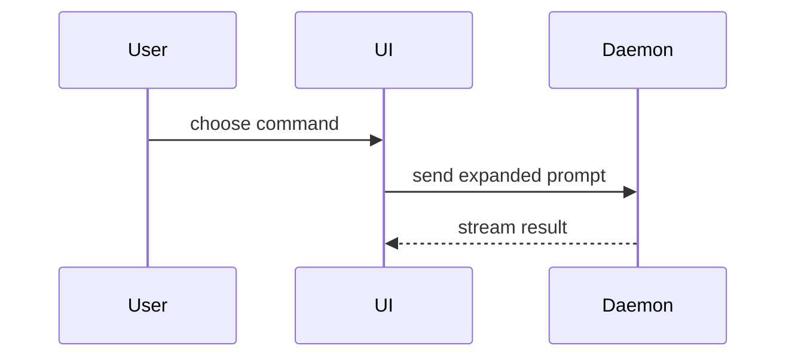

Use this template for writing the PR body:

```markdown
Refs #N

## Summary

<diagram, diff-sketch, or tree>

## Evidence

- **Before:** <screenshot/output/failing test run>
  **After:** <screenshot/output/passing test run>

## Merge Danger

**Door:** <one-way or two-way>

<optional: description>

**Blast Radius:** <one-word description>

<optional: potential ramifications of merge>

## Install

<every step installing it needs: a new permission, a data migration, a model download; or "Code only.">

Check: <the one thing Jake should try once it is installed>
```

## Lexicon additions

- **`Refs #N`** alone on the first line. It links the PR to its issue, and words after the number make it prose.
- **Scores.** A change to speech, Cleanup or the Lexicon puts its quick `lexicon-eval` scores in Evidence (words heard right, Terms right, lag). Any score that got worse goes on the line after `Refs #N`, before Summary: `Score worse: <which score, before and after>`.
- **`## Install`** after Merge Danger, listing every step installing it needs (a new permission, a data migration, a model download), or "Code only."
- **`Check:`** as the last line, with the one thing Jake should try once it is installed. A footer your tool adds may follow it.
- Keep it under about 750 words, every whitespace-separated token counted, so a long tree counts too.
- No private data: no Test set text, Wispr text, History, starter Lexicon entries or keys. Paths only.

Use `Refs`, never a closing keyword (any form of close, fix or resolve before an issue, such as "Fixed #12"), in the body and in every commit. Jake closes the issue once he has used the change.

## Sections

Skip all preambles and keep prose brief. Use the user's domain language from `GLOSSARY.md`.

### Summary

Pick the smallest view that makes the key point clear.

- Show logic or an algorithm as pseudocode:

```text
on(save)
  if content is unchanged
    return cached result
  write new content
  return fresh result
```

- Show runtime control flow as a call tree:

```text
submitForm
  createSession
    persistPrompt
    launchAgent
  navigateToSession
```

- Show UI structure as a component tree, including state and module boundaries that matter:

```text
<SessionPage> (apps/example/src/routes/session.tsx)
  useSessionEvents()
  <SessionToolbar>
    <RunSkillButton> (packages/ui)
```

- Show file responsibility or a broad refactor as a shallow file tree:

```text
src/
├── commands/       # parses user actions
├── sessions/       # owns session state
└── transport/      # sends API requests
```

- Show component interaction, control flow, or data flow with Mermaid:



- Use `diff` when the point is what changes and the surrounding shape already exists. Match the diff shape to the topic.

For a component change:

```diff
 <SessionPage>
   useSessionEvents()
   <SessionToolbar>
+    <RunSkillButton />
   <SessionTimeline>
+    <SkillResultCard />
```

For a file-layout change:

```diff
 src/
 ├── commands/
+│   └── show-me.ts       # expands the slash command
 ├── sessions/
-└── transport.ts
+└── transport/
+    ├── client.ts
+    └── stream.ts
```

For a call-tree or call-stack change:

```diff
 submitForm
   createSession
     persistPrompt
+    expandSkillMention
     launchAgent
-  navigateToSession
+  navigateToSession
+    subscribeToEvents
```

For a state or control-flow change:

```diff
 on(save)
-  write content
+  if content is unchanged
+    return cached result
+  write new content
+  invalidate cache
```

- Show the whole block when most of it is new, when omitted context would hide ownership or order, or when the user needs a copyable target shape:

```ts
function expandSkill(command: string): string {
  const skillName = command.slice(1);
  return `use the ${skillName} skill`;
}
```

#### Guidance

Place each visual next to the short text it supports. Keep only the calls, files, props, states, and boundaries needed to answer the user's current question or the options to resolve the current discussion point.

You may use one of these, you may use several, it is unlikely you will use all of them. Use your judgement and don't overwhelm the user.

### Evidence

Concrete evidence that the change works. Show a before and after.

Screenshots are S-tier - when the environment is set up for it and the change is visual (the Lexicon Dev build): cite the Live checks session's comment and its screenshot paths.

Execution-based evidence is A-tier. Test results, console output, `lexicon-eval` scores. Show the exact test that now fails and passes, using pseudocode.

### Merge Danger

Describe whether it's a one-way or two-way door. You can walk back through two-way doors, but not one-way doors. A PR that is cheap to roll back is lower risk. Changes that involve destructive actions or hard-to-reverse decisions are one-way doors.

The blast radius is the potential impact or scope of the changes introduced by this PR. Consider all possibilities. Examples for Lexicon: a lost or doubled Dictation, text typed into the wrong place, a network call in Private mode, a slower fn-up, a bigger bundle, a reset permission.
