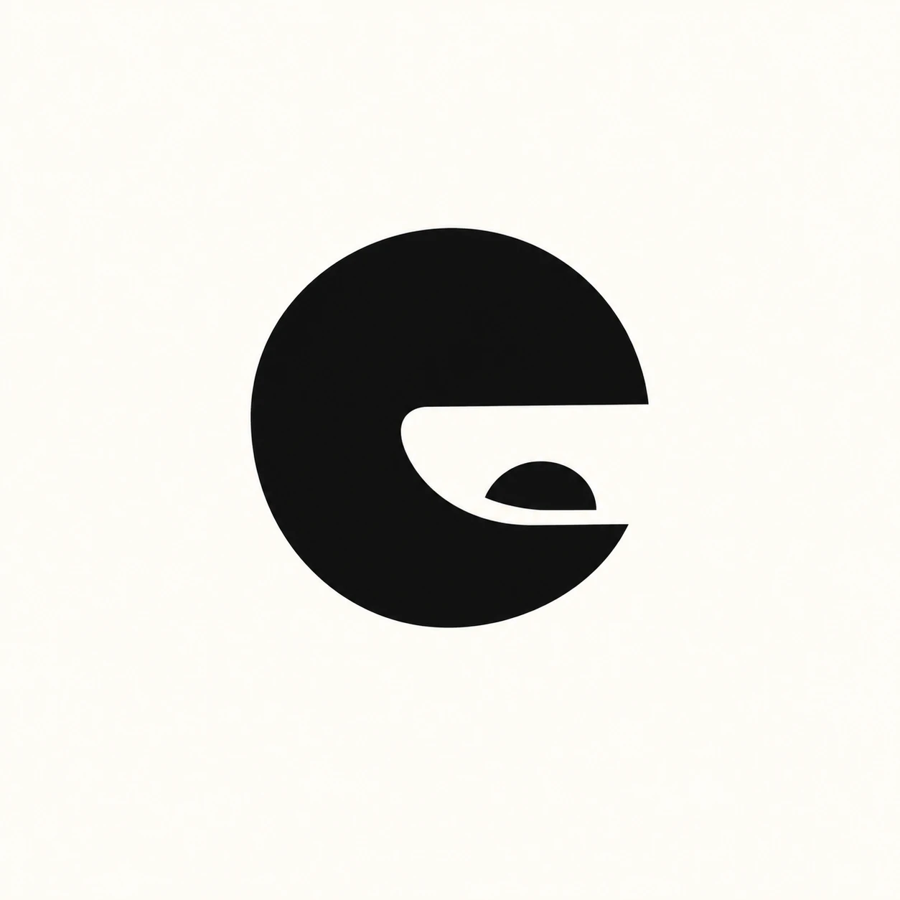

# Lexicon

A fast, native Mac dictation app that learns your words.

Hold fn and talk; Lexicon types it wherever your cursor is. Say a word wrong? Just re-speak it and Lexicon swaps it in. Fix something by hand and it asks whether to always fix it that way. Every correction makes it better.

- **Fast and native.** Swift, light, starts at login.
- **Works offline.** The best cloud speech model when you're online, the best local model when you're not.
- **Your choice of model.** Pick the speech model yourself.
- **Learns your lexicon.** Your code, your app, your past fixes teach it the words you actually say.

**Status:** planning. Nothing is built yet. The design starts from [docs/grill/2026-10-10-lexicon-grill.md](docs/grill/2026-10-10-lexicon-grill.md).

The bar: if it isn't better than Wispr Flow on my own voice, it doesn't ship.

## Build and run

Command Line Tools only (no Xcode), macOS 26. Builds are signed with a self-signed "Lexicon Dev" code signing certificate in the login keychain, so macOS keeps each app's Accessibility and Microphone grants across rebuilds.

| Command | What it does |
|---|---|
| `scripts/check.sh` | Every check: build, import rules, tests. |
| `scripts/dev-run.sh` | Builds "Lexicon Dev" (`dev.jparker.lexicon.dev`), installs it to `~/Applications/Lexicon Dev.app` and launches it. For builders. |
| `scripts/install.sh` | Builds a release of "Lexicon" (`dev.jparker.lexicon`), swaps it into `~/Applications/Lexicon.app` and relaunches it, after any Dictation in progress. The daily copy's only update command. |

The two apps have separate bundle IDs and data folders (`~/Library/Application Support/Lexicon Dev/` and `.../Lexicon/`); neither command touches the other's. Launch Lexicon with these scripts or `open`, never by running the binary: a binary run from a shell inherits the shell's Accessibility trust, so Lexicon refuses to start that way.
